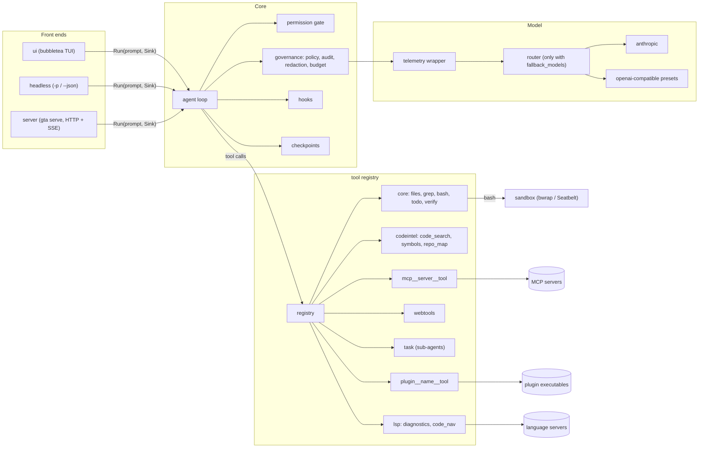

# Architecture

GTA is one Go binary. `cmd/gta` wires the packages under `internal/`
together; the packages themselves do not know about each other beyond the
interfaces they take. This page explains how the pieces fit, what happens
in one turn, and where to extend it.

## Overview



Text version:

```
UI / headless / server
        │  Run(prompt, sink)
        ▼
   agent loop ──► governance ──► telemetry ──► [router] ──► provider (Anthropic / OpenAI-compatible)
        │
        ├─► hooks (user_prompt_submit, pre/post_tool_use, stop)
        ├─► permission gate + policy ──► sink.Approve (dialog / SSE approval / headless decline)
        ├─► checkpoints (before writes)
        └─► tool registry ──► core tools ─► sandbox
                           ├► codeintel / lsp
                           ├► task ─► child agents
                           ├► MCP clients
                           └► plugin executables
```

## Packages

| Package | Role |
| --- | --- |
| `cmd/gta` | Wiring. `main.go` (flags, startup), `wire.go` (sub-agents, MCP), `toolset.go` (registry), `governance.go`, `routing.go` (telemetry and router), `codeintel.go`, `autopilot.go`, `plugins.go`, `commands.go` (slash commands, checkpoints), `caps.go`, `serve.go`. |
| `internal/agent` | The agentic loop, tool execution, governance hooks. |
| `internal/llm` | Provider-neutral messages, blocks, events and the `Provider` interface; `anthropic` and `openai` implementations. |
| `internal/router` | Retries, fallback routes, circuit breakers, client-side rate limits. |
| `internal/tools` | Built-in tools, the `Registry`, `Call` (kind, summary, preview), the workspace `Env`. |
| `internal/permission` | Permission modes, the `Gate`, destructive-command detection, session grants. |
| `internal/sandbox` | Wraps shell commands with bubblewrap (Linux) or `sandbox-exec` (macOS). |
| `internal/hooks` | Runs user hook commands at lifecycle events. |
| `internal/checkpoint` | File snapshots per turn for `/undo` and `/checkpoints`. |
| `internal/gitx` | Git helpers for `/diff`, `/commit`, `/log`, `/worktree`. |
| `internal/subagent` | The `task` tool: parallel child agents. |
| `internal/autopilot` | `/plan` (planner, reviewer, approval, executor, verifier), `/fixtests`, the `verify` tool. |
| `internal/codeintel` | Workspace index, `code_search`, `symbols`, `repo_map`. |
| `internal/lsp` | LSP client and manager; `diagnostics`, `code_nav`, after-edit diagnostics. |
| `internal/mcp` | MCP client (stdio and HTTP) and the manager that turns server tools into GTA tools. |
| `internal/plugin` | Loads `plugin.json` plugins: tools and slash commands. |
| `internal/webtools` | Client-side `web_fetch` and `web_search`. |
| `internal/policy` | Managed policy loading, clamping and enforcement. |
| `internal/audit` | Hash-chained JSONL audit log and verification. |
| `internal/secrets` | Secret detection and redaction. |
| `internal/budget` | Spend caps per session, day and month. |
| `internal/telemetry` | OpenTelemetry-compatible traces and metrics, OTLP/HTTP and file exporters. |
| `internal/server` | HTTP API, sessions, SSE event sink, approvals. |
| `internal/ui` | Terminal UI, slash command registry, approval dialog. |
| `internal/config` | Config loading, merging, validation. |
| `internal/session` | Saved conversations in `<config dir>/sessions`. |
| `internal/prompt` | Builds the system prompt (identity, environment, memory files). |
| `internal/pricing` | Price table and cost estimates. |
| `internal/version` | Build metadata. |

## Startup

`run()` in `cmd/gta/main.go`, in order:

1. Load config (defaults, user, trusted project, env), apply flags,
   validate.
2. Load the managed policy; clamp config and budgets to it.
3. Parse the permission mode, create the workspace `Env`, build the
   provider, check the model against the policy.
4. Start telemetry; wrap the provider (and build the router when
   `fallback_models` is set); configure the sandbox.
5. Load or create the session (`--resume`, `--continue`).
6. Build governance (redactor, budget, audit logger) and hooks.
7. Build the system prompt, add the repo map (waits at most 4 s for the
   index), warm the language server for the main language, run
   `session_start` hooks.
8. Build the toolset, create the agent, attach governance and code
   intelligence, add the `task` tool, set up checkpoints, start MCP
   servers (waits at most 30 s; slower servers keep connecting in the
   background and their tools appear when ready).
9. Register slash commands, then start the UI or run headless.

`gta serve` does steps 1–4 and 6–7 once, then builds one agent per API
session with its own `Env`, gate, hooks and history. It shares the
provider, governance, MCP manager, code index and plugins. Checkpoints and
`session_start` hooks are not used in serve mode.

## The agent loop

`agent.Run(ctx, userMessage, sink)` handles one user prompt. The `Sink`
interface is how a front end sees and steers the run: `Stream`,
`ToolStart`, `ToolDone`, `ToolFailed`, `Usage`, `Notice` and `Approve`.
The TUI, the headless runner and the server's SSE sink each implement it.

### Lifecycle of one turn

1. **BeforeTurn**: open a new checkpoint labelled with the prompt.
2. **user_prompt_submit hooks**: may block the prompt, or add text as a
   `<hook-context>` block.
3. Append the user message; start the `invoke_agent gta` span.
4. **Model call loop**, at most `max_turns` times:
   1. Build the request: system prompt, full history, tool specs,
      `max_tokens`, effort, thinking.
   2. **Governance before the call**: check the budget (refuses when a
      cap is reached), redact secrets in the messages.
   3. Stream from the provider (through telemetry and, if configured, the
      router). Deltas go to `sink.Stream`.
   4. **Governance after the call**: record spend, write a `model_call`
      audit record.
   5. Record usage, report `sink.Usage`.
   6. Decide what next:
      - Refusal: show a notice, drop the reply, end the turn.
      - `pause_turn` (server tools still working): call again.
      - No tool calls: end the turn, unless `max_tokens` was hit (notice)
        or a `stop` hook blocks (its reason is sent as `<stop-hook>`, at
        most 3 times).
      - Tool calls cut off by `max_tokens`: return error results, call
        again.
      - Otherwise run the tools (below), append the results, call again.
5. After `max_turns` calls, stop with a notice.

### Tool calls

For each tool call in the reply, in order:

1. **Prepare**: find the tool, validate the input against its schema,
   build a `Call` (kind `read`, `write` or `exec`, summary, preview,
   command, path). Unknown tools or bad input become error results.
2. **pre_tool_use hooks**: may block (error result), or approve.
3. **Audit check**: if the policy requires the audit log and it cannot be
   written, refuse.
4. **Policy**: `CheckTool` against the managed policy (disabled features
   and tools, the call's path, and `bash` commands). A denial is final.
5. **Permission gate**: by mode and session grants, the call is
   `Allow`, `Ask` or `Deny`. A hook approval turns `Ask` into `Allow`,
   except for destructive commands.
6. Run:
   - Allowed `read` calls run concurrently.
   - Everything else runs in order. `Ask` calls go through
     `sink.Approve` first (dialog, SSE approval, or decline when
     headless). A deny ends the turn after this batch, telling the model
     not to retry.
7. **execute**: for `write` calls, `BeforeWrite` snapshots the file. Then
   `ToolStart`, the `execute_tool` span, the tool's `Run`, an audit record
   (with redacted input), `ToolDone`. For successful writes, `AfterWrite`
   invalidates the code index and appends LSP diagnostics to the result.
   Finally **post_tool_use hooks** run; a block reason is appended to the
   result as `<post-tool-hook>`.

## Providers and routing

`llm.Provider` has `Name()` and `Stream(ctx, Request, onEvent)`. Two
implementations:

- `anthropic`: the Anthropic Messages API, with prompt caching, extended
  thinking, server-side `web_search` and `web_fetch`, and server-side
  compaction.
- `openai`: OpenAI-compatible Chat Completions. Presets set the base URL
  and key variable for `openai`, `openrouter`, `gemini`, `groq`,
  `deepseek`, `together`, `nvidia`, `ollama`, `lmstudio` and `vllm`.

The provider is always wrapped by telemetry. When `fallback_models` is
set, `router.Router` sits in front:

- Each route (primary, then each fallback) has retries with exponential
  backoff and jitter, honouring `Retry-After` up to a limit.
- Errors are classified (`rate_limit`, `overloaded`, `server_error`,
  `timeout`, `auth`, `bad_request`, …). Retryable kinds retry; others
  fall back or fail.
- A circuit breaker per route skips a failing route for a cooldown.
- Optional client-side `rpm` and `tpm` limits wait before sending.
- A stream that already produced output is not retried, so the user never
  sees text twice, unless `routing.retry_after_stream` is on.
- An attempt that streams nothing within `first_token_timeout_sec` is
  treated as a retryable timeout.

Routing events become notices (`Routing: …`), metrics and a
`gta.fallback` span event. Without `fallback_models`, the `routing`
settings are ignored.

## Tools and the registry

`tools.Registry` holds every tool with its JSON schema, kind and runner.
`cmd/gta/toolset.go` builds it from: core tools, `verify`, code
intelligence tools (when `code_index` is on), LSP tools (when `lsp` is
on), client web tools (non-Anthropic providers, or `client_web_tools`),
plugin tools, the `task` tool and MCP tools. When plugins are reloaded or
an MCP server connects, the registry is rebuilt and swapped atomically;
the next model call sees the new list.

Each tool runs against `tools.Env`, which knows the workspace root,
resolves paths, tracks which files have been read (edits need a prior
read), and wraps shell commands with the sandbox.

## Permissions and governance

Two independent layers decide whether a call runs:

- The **permission gate** (`internal/permission`) applies the user's mode
  (`ask`, `auto-edit`, `plan`, `yolo`), the `allow_commands` list, session
  grants, and destructive-command detection.
- **Governance** (`internal/agent/governance.go` plus `policy`, `audit`,
  `secrets`, `budget`) applies organisation rules and records what
  happened. The managed policy can forbid tools, commands, paths, models,
  providers and modes, and cap the mode the user can pick.

See [security.md](security.md) for details.

## Sub-agents

The `task` tool (`internal/subagent`) runs up to 8 child agents per call,
4 at a time, each limited to 40 model calls:

- `explore`: read-only tools (`read_file`, `list_dir`, `glob`, `grep`) in
  `plan` mode. The call itself is `read` kind.
- `general`: every base tool except `task`, in `ask` mode; approvals are
  delegated to the parent's sink. The call is `exec` kind.

Children share the parent's provider and environment, get a child
governance (same policy, audit and budget) and the same `AfterWrite`.
Their usage is added to the parent's, and progress is reported through
`SubagentProgress` when the sink supports it.

## Autopilot

`internal/autopilot` drives structured work with child agents:

- `/plan <task>`: a planner agent writes a plan, a reviewer critiques it
  (up to 2 rounds), the user approves in a dialog, the agent executes,
  and a verifier compares the diff and test results with the plan.
- `/fixtests [n]`: runs the detected test command, has the agent fix
  failures, and repeats up to `n` rounds, stopping after 2 rounds without
  progress.
- `verify` tool: runs the detected test command (through the sandbox) so
  the model can check its own work.

## Code intelligence

- `internal/codeintel` indexes the workspace in parallel (files up to
  1 MiB, at most 200,000 files), caches it in `<config dir>/index`, and
  serves `code_search`, `symbols` and `repo_map`. A compact repo map is
  added to the system prompt as `<repo-map>`.
- `internal/lsp` starts language servers on demand (defaults: `gopls`,
  `typescript-language-server`, `pyright-langserver`, `rust-analyzer`,
  `clangd`; more via `lsp_servers`). After an edit, it waits briefly for
  diagnostics and appends new errors to the tool result.

## MCP

`internal/mcp` connects to the servers in `mcp_servers` (stdio commands
or HTTP URLs), lists their tools and exposes each as
`mcp__<server>__<tool>`, always `exec` kind so the gate asks in `ask`
mode. `/mcp reconnect <name>` restarts one. In `gta serve`, one manager is
shared by all sessions.

## Plugins

`internal/plugin` loads directories with a `plugin.json` from the user
plugin directory and, for trusted projects, `.gta/plugins`. Plugins add
tools (`plugin__<plugin>__<tool>`, run as a child process with JSON on
stdin and stdout) and slash commands (prompt templates or commands). See
[plugins.md](plugins.md).

## UI

`internal/ui` is a bubbletea program rendered inline (no alternate
screen), so output stays in the terminal's scrollback. It owns the input
box, completions, the approval dialog and the status line. Slash commands
live in a registry: built-ins in `ui`, and the rest registered by
`cmd/gta` through `ui.Register(ui.Extra{…})`.

## Server

`internal/server` exposes sessions over HTTP. Each session wraps an
agent; a turn runs with an `EventSink` that turns `Sink` calls into SSE
events and turns `Approve` into an `approval_required` event plus a wait
for `POST …/approvals/{id}`. See [server-api.md](server-api.md).

## Extension points

| Want to | Use | Code change? |
| --- | --- | --- |
| Add a tool or slash command | A plugin ([plugins.md](plugins.md)) | No |
| Connect external tools and data | An MCP server in `mcp_servers` | No |
| Run checks or inject context around prompts and tools | `hooks` | No |
| Add a language | `lsp_servers` | No |
| Survive provider outages | `fallback_models`, `routing` | No |
| Enforce rules for a team | A managed policy ([security.md](security.md)) | No |
| Drive GTA from another program | `gta serve` or `gta -p --json` | No |
| Give project instructions | `AGENTS.md`, `GTA.md` or `CLAUDE.md` | No |
| Add a built-in tool | Implement it in `internal/tools` and add it in `cmd/gta/toolset.go` | Yes |
| Add a provider | Implement `llm.Provider`, or add an OpenAI-compatible preset | Yes |
| Add a slash command in code | `ui.Register(ui.Extra{Name, Args, Help, Run / Prompt / Job})` in `cmd/gta` | Yes |
| Add a front end | Implement `agent.Sink` and call `agent.Run` | Yes |
